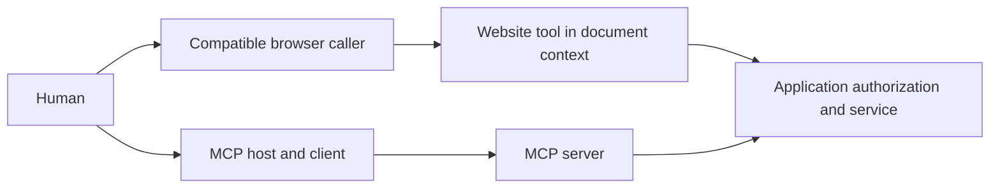

# WebMCP versus MCP: choose the integration boundary

## Which problem are you solving?

Use a browser-facing WebMCP experiment when the task belongs to a website's existing browsing context and a compatible caller can discover that site's structured actions. Use MCP architecture when a host/client needs a server's tools, resources or prompts through an MCP transport. They share an interest in structured tool use, but their hosting, discovery and lifecycles differ.

| Question | WebMCP | MCP architecture |
| --- | --- | --- |
| Where does site-facing logic live? | Website/document and its application handlers | Server implementing protocol capabilities |
| What context matters? | Origin, window, active document, application session | Host/client/server connection and configured identity |
| What is discovered? | Registered website tools in supported browsing contexts | Negotiated server capabilities such as tools/resources/prompts |
| How long does it live? | Registration and document/application lifecycle | Client-server session/connection lifecycle |
| Where must permission be enforced? | Application/server operation boundaries | Host policy and server/resource boundaries |
| Does it make all clients compatible? | No; browser and caller support required | No; host capabilities, transport and server setup required |

## A concrete example

A user browses a fictional catalogue and asks an agent to find a suitable lamp. A WebMCP search tool can expose query and price constraints and return product identifiers from that site. A server-side MCP integration might let a separate host query an inventory service even when the website is not open. Neither design makes purchases authorized simply because an agent found a product.

This is a conceptual boundary diagram, not a claim that every host or browser supports both paths. A project may use both architectures when there are separate user needs. Avoid adding a server layer solely because an old tutorial conflates the names.

## Why can't a public scan verify support?

A crawl sees content and perhaps source hints. It may not run the same browser feature, session, document lifecycle or caller that discovers and invokes a registered tool. Verification needs the named environment and a successful interface invocation with an expected result. The [compatibility worksheet](compatibility-and-debugging.md) keeps those claims separate.

## What should a website team publish?

Publish the supported action contract, access rules, compatibility setup, tested outcomes and failure/confirmation behavior. For a pre-launch service, distinguish proposed workflow from an available integration. Neither architecture promises search ranking or agent recommendations.

Sources: [WebMCP draft](https://webmachinelearning.github.io/webmcp/), [Chrome comparison](https://developer.chrome.com/docs/ai/webmcp/compare-mcp), [MCP architecture](https://modelcontextprotocol.io/docs/2026-07-28/learn/architecture). Reviewed 19 November 2026.
